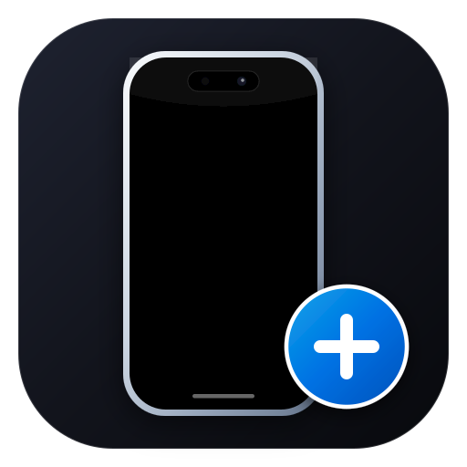
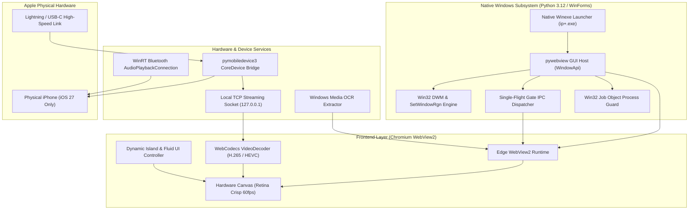
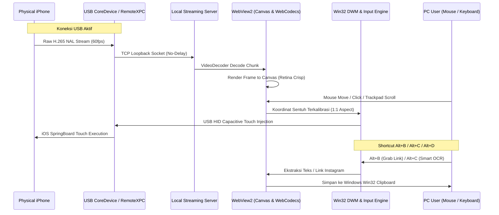

  

<h1 align="center">ip+</h1>

  <b>Native 60fps iPhone Mirroring &amp; Control Platform for Windows 11 (iOS 27 Exclusive)</b>

  
  
  
  
  
  

  Platform desktop native Windows modern berkinerja tinggi untuk <i>screen mirroring</i> dan kontrol penuh perangkat Apple iPhone melalui koneksi kabel USB berkecepatan tinggi tanpa kompresi atau latensi jaringan Wi-Fi.

---

Didesain dengan standar kriya tinggi (*high craft & design engineering*), sistem ini menghadirkan pengalaman visual sasis fisik **Apple Space Black Titanium**, kelengkungan kontinu **Apple $G^2$ Squircle**, pulau kamera **Dynamic Island** responsif berbasis rasio matematis, arsitektur *Single-Flight Gate* 60 FPS tanpa lag, serta peluncur native tanpa konsol CMD (**`ip+.exe`**) layaknya aplikasi desktop profesional komersial.

---

##  Arsitektur Aplikasi & Infrastruktur

Sistem **ip+** dibangun dengan arsitektur hibrida decoupled yang memisahkan lapisan rendering antarmuka pengguna, jembatan window management Windows OS, dan komunikasi protokol USB perangkat keras Apple.

###  Pola Arsitektur Utama
- **Zero-Copy WebCodecs H.265 Pipeline**: Paket NAL unit H.265 dialirkan langsung melalui socket loopback TCP berlatensi rendah ke WebCodecs `VideoDecoder` perangkat keras tanpa konversi bitmap perantara.
- **Win32 SetWindowRgn DWM Squircle Clipping**: Jendela aplikasi dipotong pada level kernel grafis Windows menggunakan kurva $G^2$ Squircle ($58\text{px}$ pada Portrait, $48\text{px}$ pada Landscape), memberikan $100\%$ transparansi sudut sempurna dan *click-through* alami di luar bodi iPhone.
- **Single-Flight Gate 60 FPS Resize**: Menggunakan mekanisme penguncian *Promise-based in-flight* pada antrean IPC pywebview sehingga perbesaran dan pengecilan jendela merespons koordinat mouse secara instan tanpa lag backlog atau *thread explosion*.
- **Zero-Console Winexe Subsystem**: Menggunakan wrapper binary C# yang dikompilasi dengan `/target:winexe` dan memanggil `pythonw.exe` (`IMAGE_SUBSYSTEM_WINDOWS_GUI`) secara *hidden*, mengeliminasi jendela hitam konsol CMD secara total.
- **Win32 Job Object Lifecycle**: Menjaga semua proses anak (audio worker, server, socket) di dalam kernel Windows Job Object dengan bendera `JOB_OBJECT_LIMIT_KILL_ON_JOB_CLOSE`, menjamin nol proses tertinggal (*zero zombie processes*) saat jendela ditutup.

---

##  Alur Kerja Streaming & Kontrol Input (Flow Pipeline)

Diagram berikut menjelaskan siklus tertutup (*closed-loop lifecycle*) dari penerimaan video layar hingga injeksi sentuhan kapasitif mouse:

---

##  Fitur Unggulan

### 1.  Bodi Fisik Real iPhone & Dynamic Island Responsif
- **Apple CAD Titanium Space Black Chassis**: Bodi ponsel berketebalan presisi $12\text{px}$ Space Black Titanium dengan lengkungan baku Apple $G^2$ Squircle ($58\text{px}$ Portrait, $48\text{px}$ Landscape).
- **Proportional Dynamic Island Scaling**: Pulau notch kamera TrueDepth FaceID dan sensor depan secara dinamis membesar dan mengecil mengikuti skala jendela menggunakan perhitungan matematis `vw` dan `vh` terisolasi, lengkap dengan animasi ekspansi hover mulus (durasi $\le 200\text{ms}$).
- **Anti-Gepeng Strict Aspect Ratio Locking**: Rasio aspek terkunci mutlak pada rasio native iPhone ($1179 / 2556 \approx 0.4612$) dengan kompensasi bezel fisik $24\text{px}$, menjamin proporsi layar tidak pernah melar atau penyek saat ditarik.
- **Center Screen Precision**: Jendela utama dan jendela pengaturan secara otomatis terbuka tepat di titik tengah (*center screen*) monitor kerja aktif Anda.

### 2.  Zero-Copy 60fps H.265 (HEVC) Streaming + Smart Motion PLI
- Streaming video langsung dari chip enkoder hardware iPhone ke GPU Windows melalui Edge WebView2 WebCodecs dengan latensi mendekati nol.
- Dilengkapi **Smart Motion PLI Keyframe Booster** ($180\text{ms}$ pasca-swipe) yang menjaga ketajaman teks dan gambar selama transisi animasi atau navigasi folder cepat.

### 3.  Zero-Console Native Desktop Launcher (`ip+.exe`)
- Dijalankan langsung melalui file biner `ip+.exe` yang menargetkan subsistem Windows GUI.
- Tidak ada jendela hitam Command Prompt (`cmd.exe`) atau konsol Python yang berkedip di layar, memberikan estetika aplikasi komersial berkelas.

### 4.  37-Scenario Smart Auto-Rotate (`Alt+H`)
- Mendeteksi orientasi layar secara otomatis: langsung berputar ke **270° Widescreen Landscape** (dengan pemetaan sentuh terbalik 1:1) saat membuka game atau video layar penuh.
- Tetap stabil pada mode **0° Portrait** saat berada di iOS Home Screen, folder aplikasi, WhatsApp, TikTok, atau Instagram.

### 5.  1-Click Social Link Grabber (`Alt+B`) & Multi-Paragraph OCR (`Alt+C`)
- **1-Click Grab Link (`Alt+B`)**: Menyalin tautan postingan, Reels, atau Threads langsung dari layar iPhone ke Clipboard Windows hanya dalam $\approx 1.3$ detik tanpa perlu membuka menu bagikan.
- **Multi-Paragraph Smart OCR (`Alt+C`)**: Mengekstrak teks dari gambar, percakapan WhatsApp, atau catatan Apple Notes dengan mempertahankan susunan paragraf asli menggunakan Windows Media OCR.

### 6.  Kontrol Kapasitif USB HID 1:1 & Trackpad Dua Jari
- Kontrol sentuh mulus dengan dukungan klik, tahan, seret (*drag*), geser (*swipe*), dan scrolling halus dua jari pada trackpad laptop.
- Meneruskan shortcut pengetikan native iOS (`Ctrl+A`, `Ctrl+C`, `Ctrl+V`, `Ctrl+X`, `Ctrl+Z`).

### 7.  Physical OLED Stealth Dim 0% (`Alt+D`) & Remote PIN Unlock (`Alt+U`)
- Menurunkan kecerahan layar iPhone fisik menjadi $0\%$ (gelap total di meja) untuk menjaga privasi dan menjaga suhu baterai tetap dingin selama *mirroring*.
- Membangunkan layar dan memasukkan kode PIN secara otomatis via USB HID dengan shortcut `Alt+U`.

### 8.  Jendela Pengaturan Modern (macOS Style)
- Jendela pengaturan mandiri (*standalone window*) terpisah bergaya macOS Ventura/Sonoma dengan tab navigasi bersih, pencarian shortcut instan, dan konfigurasi performa.

---

##  Tech Stack & Ketergantungan

| Layer | Teknologi & Komponen | Deskripsi & Peran |
| :--- | :--- | :--- |
| **Desktop Launcher** | C# 5.0 / .NET Framework 4.0 (`/target:winexe`) | Biner native `ip+.exe` tanpa konsol CMD |
| **GUI Framework** | Python 3.12, `pywebview` 5.x, WinForms | Jembatan windowing frameless berakselerasi hardware |
| **Window Compositor** | Windows DWM (`dwmapi.dll`, `user32.dll`, `gdi32.dll`) | Transparansi per-pixel, DWM acrylic & squircle region |
| **Frontend Web** | HTML5, Vanilla JavaScript (ES2022), CSS3 Modern | Antarmuka bodi iPhone, Dynamic Island, dan settings |
| **Rendering Engine** | Microsoft Edge WebView2 (Chromium Blink) | Rendering hardware canvas 60 FPS |
| **Video Decoding** | WebCodecs API (`VideoDecoder` H.265 / HEVC) | Dekoder video akselerasi GPU perangkat keras |
| **USB Communication** | `pymobiledevice3` (CoreDevice, RemoteXPC) | Protokol penghubung USB data iPhone |
| **Audio Routing** | WinRT `AudioPlaybackConnection` (A2DP Bluetooth Sink) | Penerima audio nirkabel berlatensi rendah ke speaker PC |
| **OCR Engine** | Windows Media OCR (`Windows.Media.Ocr`) | Pemindai teks multi-bahasa dari canvas video |

---

##  Garis Keturunan & Atribusi Open-Source (Open-Source Lineage & Credits)

Proyek **ip+** merupakan hasil pengembangan, pembaruan, dan refaktorisasi terbuka yang berdiri di atas fondasi karya luar biasa komunitas open-source:

- **Pembuat Awal & Arsitek Proyek Fondasi**:
  - **Kelvin Daniyar** ([@kelvindaniyar](https://github.com/kelvindaniyar)) — Pencipta dan pengembang awal **iPhone Link v2.0** yang merancang mesin streaming 60fps H.265, Smart Motion PLI, Smart Auto-Rotate 37 skenario, dan integrasi shortcut iOS.
  - **teyboxv1** ([teyboxv1/pane-iphone-mirror-windows](https://github.com/teyboxv1/pane-iphone-mirror-windows)) — Pencetus proyek sumber terbuka asli *Pane iPhone Mirror for Windows*.
  - **Doron Zavelevsky** ([pymobiledevice3](https://github.com/doronz88/pymobiledevice3)) — Arsitek pustaka protokol Apple CoreDevice dan RemoteXPC via USB.

- **Pengembang & Penyempurna `ip+`**:
  - **Iqsan Azhar** ([@iqsanazhr](https://github.com/iqsanazhr)) — Melakukan refaktorisasi total arsitektur bodi fisik:
    - Merancang sasis fisik $12\text{px}$ Space Black Titanium dengan kelengkungan kontinu Apple $G^2$ Squircle ($58\text{px}$ Portrait, $48\text{px}$ Landscape).
    - Membangun pulau kamera **Dynamic Island** responsif berbasis *fluid scaling* (`vw` & `vh`) dengan rasio proporsional 1:1.
    - Mengimplementasikan arsitektur *Single-Flight Gate* 60 FPS untuk eliminasi lag pada *window resizing*.
    - Menghadirkan peluncur native tanpa jendela konsol CMD (**`ip+.exe`**).
    - Menyempurnakan sistem penempatan jendela *center screen* untuk jendela utama dan jendela pengaturan.
    - Menjamin penguncian rasio aspek fisik anti-gepeng dengan kompensasi bezel $24\text{px}$.

---

##  Referensi Shortcut Keyboard

| Shortcut | Aksi | Deskripsi |
| :---: | :--- | :--- |
| **`Alt + B`** | ** 1-Click Grab Link** | Mengekstrak URL Instagram (Feeds/Reels) atau Threads langsung ke Clipboard PC dalam $\approx 1.3\text{ detik}$. |
| **`Alt + C`** | ** Smart OCR Copy Text** | Menjalankan Windows Media OCR pada layar iPhone dan menyalin teks multi-paragraf ke Clipboard PC. |
| **`Alt + V`** | ** Paste PC Text to iPhone** | Mengetikkan/menginjeksikan teks dari Clipboard Windows langsung ke kolom input iOS yang aktif. |
| **`Alt + H`** | ** Toggle Landscape (270°)** | Beralih antara mode Portrait vertikal ($0^\circ$) dan Landscape gaming horizontal ($270^\circ$). |
| **`Alt + D`** | ** Toggle USB Stealth Dim** | Mematikan layar fisik iPhone ke $0\%$ (gelap di meja) atau mengembalikan kecerahan normal $\approx 25\%$. |
| **`Alt + U`** | ** Remote Wake & Unlock** | Membangunkan iPhone, melewati layar Face ID, dan menginput PIN keamanan via USB HID. |
| **`Alt + L`** | ** Lock iPhone Screen** | Mengunci layar iPhone dan memasukkannya ke mode standby dengan aman. |
| **`Alt + S`** / **`Ctrl + ,`** | ** Buka Pengaturan (Settings)** | Membuka jendela pengaturan modern ip+ bergaya macOS di tengah layar. |
| **`Ctrl + K`** | ** Toggle Virtual Keyboard** | Menampilkan atau menyembunyikan keyboard virtual iOS pada layar ponsel. |
| **`Ctrl + A / C / V / X / Z`** | ** Native iOS Editing** | Mengirimkan perintah edit native iOS (`Cmd+A`, `Cmd+C`, `Cmd+V`, `Cmd+X`, `Cmd+Z`). |
| **`Ctrl + Scroll`** / **`Ctrl + +/-`** | ** Zoom & Skala Jendela** | Memperbesar atau memperkecil ukuran jendela dengan rasio aspek $1:1$ terkunci. |

---

##  Panduan Memulai Cepat (Quick Start)

###  Kebutuhan Sistem
1. **Sistem Operasi**: Windows 10 atau Windows 11 (64-bit).
2. **Perangkat**: Apple iPhone yang menjalankan **iOS 27 saja** (eksklusif iOS 27, terverifikasi penuh pada iOS 27.0.1). Versi iOS selain 27 tidak didukung.
3. **Kabel Koneksi**: Kabel data USB-to-Lightning atau USB-C ke PC.
4. **Driver**: Apple Mobile Device Support / iTunes (atau terpasang otomatis via Windows Update).

###  Cara Menjalankan
1. Hubungkan iPhone ke PC menggunakan kabel data USB dan pilih **"Percayai Komputer Ini"** (*Trust This Computer*) pada layar iPhone Anda.
2. Jalankan aplikasi melalui salah satu cara berikut:
   - **Klik Ganda `ip+.exe`** di folder aplikasi (atau icon **`ip+`** di Desktop Anda).
   - Aplikasi akan langsung melayang di tengah layar Anda tanpa jendela konsol hitam CMD.

---

##  Lisensi

Proyek ini didistribusikan di bawah lisensi **GNU General Public License v3.0 (GPL-3.0)** sesuai dengan silsilah dan lisensi komponen dasar open-source yang digunakan. Silakan lihat berkas [LICENSE](LICENSE) untuk ketentuan hukum selengkapnya.

---

  <b>ip+</b> &bull; Crafted with precision by <b>Iqsan Azhar</b> &bull; Built on the open-source shoulders of <b>Kelvin Daniyar</b> &amp; <b>teyboxv1</b>

